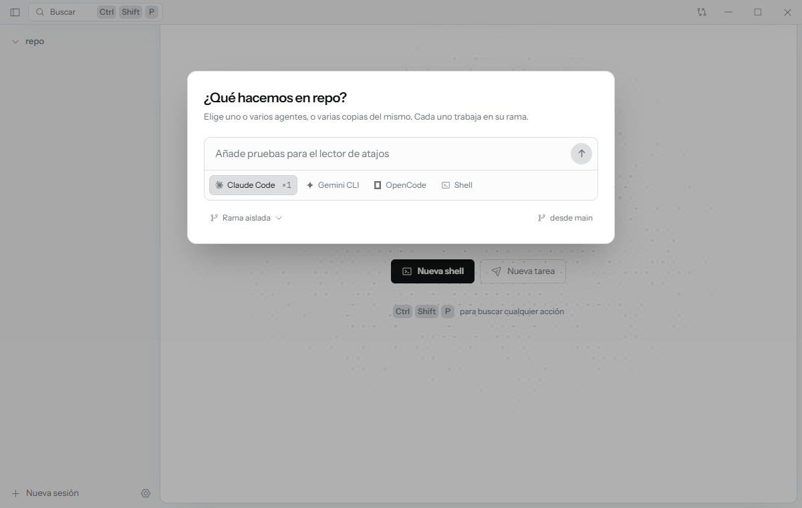
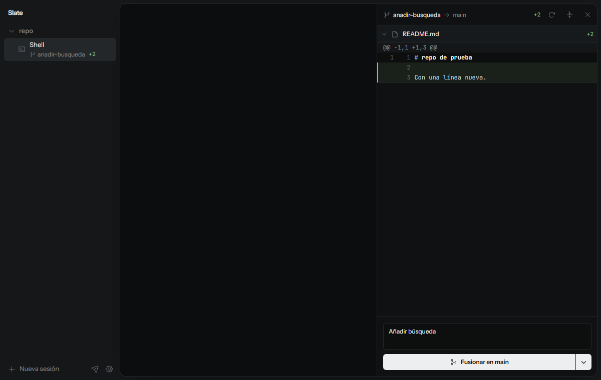
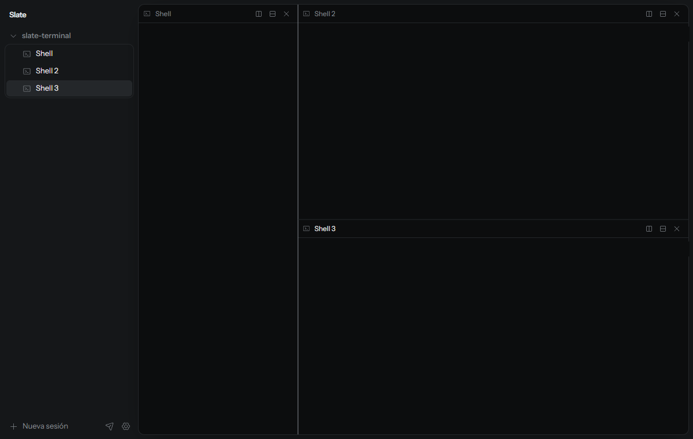

# Slate

Una terminal para trabajar con agentes de IA (Claude Code, Codex, Gemini CLI, OpenCode…). Cada
carpeta agrupa sus sesiones, y Slate te avisa cuando un agente te necesita o termina.



## Qué hace

- **Sesiones por carpeta.** Shells y agentes ordenados bajo su proyecto, con un trazo en el
  borde de cada fila: brilla mientras el agente trabaja y se vuelve ámbar cuando te necesita.
  Claude Code informa por hooks; los demás agentes, por su salida.
- **Divisiones.** Varias terminales en una misma vista, a la derecha o debajo.
- **Tareas en paralelo.** Lanza una tarea a uno o varios agentes (o varias copias del mismo),
  o apila varias tareas con `Ctrl Enter` y lánzalas juntas. Cada agente trabaja en su propia
  rama, en un worktree aparte, sin pisar a los demás.
- **Tablero.** Todas las sesiones a la vista como tarjetas vivas: estado, rama, cambios y lo
  último que imprimió cada terminal. Se abre solo al lanzar varias tareas.
- **Panel de cambios.** Lo que tocó cada sesión, con su diff resaltado. Desde ahí lo fusionas en
  tu rama (un solo commit, sin créditos de agente), abres un PR o lo descartas.
- **Orquestación.** Claude Code recibe herramientas de Slate por MCP para lanzar tareas, leer la
  pantalla de otra sesión, escribirle, esperar a que termine y avisar a quien le encargó algo.
- **Sesiones que sobreviven.** Al cerrar Slate, las terminales siguen trabajando en segundo
  plano. Al abrirlo vuelven con lo que imprimieron y en la misma disposición.
- **A tu medida.** Temas en grises (Grafito, Carbón, Pizarra, Humo; Tiza, Papel, Niebla), tamaño
  de la interfaz, fuente instalada, espaciado, grosor, shell, tamaño del código de los diffs y
  ancho del panel de cambios.
- **Actualizaciones con un clic** desde Ajustes, avisos del sistema y seguir en la bandeja.



## Instalar

Descarga `slate-<versión>-setup.exe` y ábrelo. Se instala para tu usuario, sin pedir permisos
de administrador, y crea los accesos en el escritorio y en el menú Inicio.

Después, Slate se actualiza solo desde Ajustes › Actualizaciones: cada push a `develop` publica
una versión nueva en GitHub Releases.

El instalador no está firmado. Por eso Windows SmartScreen puede decir _"Windows protegió su
PC"_: pulsa **Más información** y luego **Ejecutar de todas formas**.

## Atajos

| Acción                           | Windows y Linux                 | macOS                   |
| -------------------------------- | ------------------------------- | ----------------------- |
| Paleta de comandos               | `Ctrl Shift P`                  | `Cmd K`                 |
| Nueva shell                      | `Ctrl Shift T`                  | `Cmd T`                 |
| Nueva tarea                      | `Ctrl Shift A`                  | `Cmd Shift A`           |
| Dividir a la derecha / abajo     | `Ctrl Shift D` / `Ctrl Shift E` | `Cmd D` / `Cmd Shift D` |
| Mostrar los cambios              | `Ctrl Shift G`                  | `Cmd Shift G`           |
| Tablero de sesiones              | `Ctrl Shift O`                  | `Cmd Shift O`           |
| Siguiente sesión que te necesita | `Ctrl Shift J`                  | `Cmd J`                 |
| Buscar en el terminal            | `Ctrl Shift F`                  | `Cmd F`                 |

La lista completa está en Ajustes › Atajos.



## Desarrollo

```bash
npm install
npm run dev          # app con recarga en caliente
npm run check        # pruebas de la lógica (estados, disposición, atajos, git)
npm run look         # recorrido completo de la app con Playwright; capturas en .look/
npm run build:win    # instalador de Windows en dist/
npm run look:exe     # el mismo recorrido sobre dist/win-unpacked (tras npm run build:unpack)
```

Las pruebas nunca lanzan agentes con una tarea: usan shells e imitan sus hooks.

Si el host de sesiones falla al arrancar, su error queda en `host.log`, dentro de la carpeta de
datos (Ajustes › Avanzado › Abrir carpeta).

Hecho con Electron, React, xterm.js y node-pty.
